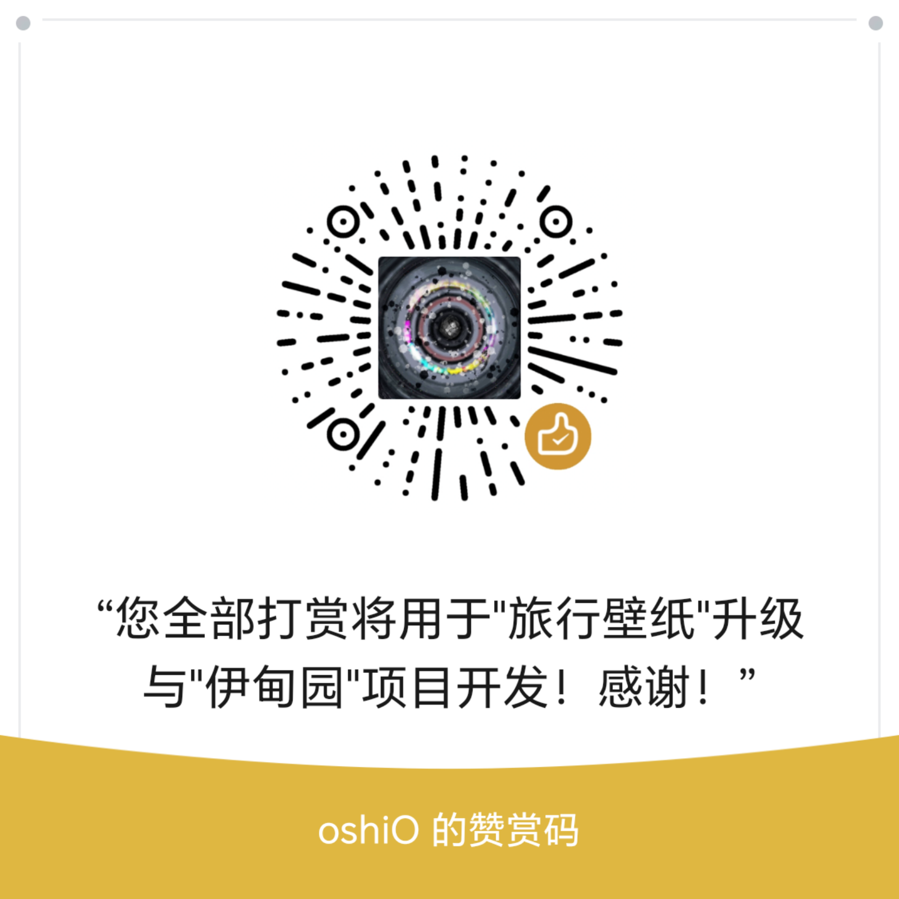

# 旅行壁纸

**带上喜欢的角色，每天前往一个新世界。**

今天陪大肥鱼逛宋朝夜市，明天让龙娘走进云海里的纸鸢峡谷。也可以上传自己的照片或原创角色，让赛博分身替你出发；或者不带角色，只看一个世界如何生活。

旅行壁纸运行在 **DeepSeek Harness（DSH）** 中，把你的角色、世界和画风设定整理成提示词，生成并应用桌面壁纸，同时留下世界见闻与角色来信。你可以回信安排下一件小事，也可以干涉世界，让下一张图呈现你的选择。

**选择角色 → 到达世界 → 看见事件 → 收到来信 → 作出选择 → 生成下一幕 → 留下旅行档案。**

作者：**消尽森（chokingson）** · [项目仓库](https://github.com/chokingson/dsh-travel-wallpaper) · [问题反馈](https://github.com/chokingson/dsh-travel-wallpaper/issues)

> 插件免费，生图使用你自己的账户、额度或本地环境。当前 0.14.1 是待完成全面实机测试的候选版本；已完成的本地自动检查不等于全部渠道、所有设备都已验证。可以直接安装发行包，不必等市场收录。

## 能怎么玩

| 你想做什么 | 可以这样玩 |
| --- | --- |
| 带大肥鱼看世界 | 今天逛宋朝夜市，明天搭海底文明的鲸鱼公交。来信只讲一件小事，例如给你挑了一份会唱歌的点心。 |
| 让赛博分身替你旅行 | 上传自己的照片或原创角色。现实中还在上班，桌面里的自己已经坐上蒸汽飞艇看日落。 |
| 看二次元角色闯进电影画面 | 让背景使用写实雨城、电影灯光，人物继续保留参考图的二次元形象。参考约束会进入提示词，最终一致性仍取决于生图模型。 |
| 给角色回一封信 | “给主人带一瓶不会熄灭的极光。”“别急着离开，帮那家面包店想想办法。”让下一幕响应你的安排。 |
| 当世界导演 | 帮沙漠文明找到地下河，改变一场革命，或让居民开始收藏世界上最后一滴雨。 |
| 去梗宇宙旅游 | 在“华强买瓜世界”参加瓜议会听证，把加班写成时间税，把拥挤地铁写成星际传送门限流。现实话题可以自己输入。 |
| 收藏外星报纸 | 把见闻放进报纸、竹简、石壁公告、全息屏和广告大屏；也可以选择完全无字的风景。 |
| 只看风景和文明 | 开启“观察世界”，不设置旅行主角，不生成角色日记与来信，只看世界本身发生的事情。 |

### 已经出发过的旅行

以下是作者提供、由插件流程生成的示例。它们展示可创作的画面，不代表每次生成都能得到完全相同的效果。

**大零蛋超商夜班共和国 · Claude 大小姐**

**下一站江东 · DS大肥鱼（早期样图）**

**纸鸢风骨峡 · GPT 龙娘**

## 三种出发方式

| 按钮 | 会发生什么 |
| --- | --- |
| **制作今日壁纸** | 按当前确认的设定创作新的一组。同一天也能再次制作，适合重画你已经选好的世界。 |
| **立即盲盒旅行** | 保留角色与当前画风、参考图、渠道和尺寸，让 DSH 创作预设之外的新世界、新事件。每次完成后都可以再次出发。 |
| **盲盒旅行预订** | 预订明天的未知目的地，到设定时间后执行。DSH 需要保持运行；关机时不会在后台凭空生成。 |

生成中会显示等待状态，避免重复提交；完成后显示生成与壁纸应用结果。失败时查看具体原因，重新生成可能消耗新的渠道额度。

## 第一次使用

1. **安装 DSH，再安装旅行壁纸。** 使用作者提供的 `.tgz` 插件包；安装说明见下方。无需另装生图插件，也不强制购买 Wallpaper Engine。
2. 打开 **DSH 设置 → 旅行壁纸 → 渠道设置**，配置可用的生图订阅、API 或本地通道。文字整理默认使用 DSH 的 DeepSeek Flash 通道；生图账户与文字通道不是同一件事。
3. 回到“每日壁纸”，选择 **角色旅行／观察世界**、**文生图／图生图**。想保持角色外形时，可在图生图面板选默认参考图，或上传自己的参考图。
4. 在“创作提示词”填写想去的地方、发生的事、画风及额外要求，确认并保存设置。
5. 点击 **制作今日壁纸**。第一次建议先用一张、默认尺寸，确认渠道可用和壁纸能更换，再开启每日任务或多图轮播。
6. 想交给未知目的地，就选 **立即盲盒旅行**；想看历史作品，到 **已到访世界**。

灰字是示例提示，输入后会消失，不会强行变成你的需求。20 种画风支持鼠标悬浮预览，用户提示词、世界与 tag 都可以修改。内置 Skill 规范可关闭；它帮助整理提示词，不保证消除所有生成错误。

## 怎么安装

1. 下载并打开 **DeepSeek Harness（DSH）**，登录、配置可用的模型账户。
2. 下载作者提供的 **`旅行壁纸-0.14.1.tgz`**。只需要这一个安装包，不需要整堆源码。
3. 新建聊天，把安装包作为附件交给 DSH，说：**“帮我安装这个旅行壁纸插件，装好后告诉我怎么用。”**
4. 安装完成后，进入 **DSH 设置 → 旅行壁纸**，配置生图渠道，选角色和世界，再制作第一张壁纸。

如果附件入口不接受这个文件，或者 AI 没有完成安装，见 **[简明安装说明](docs/INSTALL.md)**。上传附件这一步仍待实机验证，不能把发出了文件当作已经安装成功。

插件免费，生成图片需要自己的可用账户与额度。账户是否有赠送额度、额度能否用于生图，以服务实际显示为准。仓库已经公开；安装包与版本更新以 [Releases](https://github.com/chokingson/dsh-travel-wallpaper/releases) 为准。收录到 DSH 插件市场后，也可以在 **DSH 设置 → 插件市场** 里搜到「旅行壁纸」并一键安装。

## 需要什么账户和软件

| 项目 | 是否需要 |
| --- | --- |
| **DeepSeek Harness** | 必须。插件设置、写稿和定时任务运行在 DSH 中。 |
| **可用的文字通道** | 用于整理提示词、创作世界和短消息。默认 DeepSeek Flash、推理 Off；需在 DSH 中可用。 |
| **生图订阅、API 或本地环境** | 至少准备一种。插件不赠送额度，也不替用户购买订阅。 |
| **Wallpaper Engine／小红车** | 可选。Windows 静态壁纸不需要它；1—20 张轮播使用它。 |
| **其他生图插件** | 不需要。旅行壁纸内置渠道适配代码。 |
| **ComfyUI／MOSS** | 可选，主要保留为本地测试路径，需要用户自行安装模型与环境。 |

### 渠道与验证范围

| 通道 | 当前说明 |
| --- | --- |
| **ChatGPT 订阅** | 项目已有真实生成示例；当前版本与不同账号、套餐的完整流程仍需各自验证。使用兼容登录协议，不是平台为本插件保证长期可用的公开生图 API。 |
| **Google／Antigravity 订阅** | 已有适配入口；不表示任意 Google AI 订阅都能使用。资格、模型权限与额度取决于账户，尚不承诺全套餐验证通过。 |
| **OpenAI／兼容 API、Gemini、火山 Seedream** | 已有直连配置入口；填写自己的密钥、服务地址与模型。不同服务及账号逐项验证，不把接口实现等同于实测通过。 |
| **本地 MOSS** | 保留 25 步文生图工作流供本地验证，不作为大众必需安装项。 |

本机记录的宿主为 **DSH 桌面版 0.2.2-rc.1，Windows 11**。这是核对到的本机环境，不是最低兼容版本承诺。Windows 10、其他 DSH 版本及混合 DPI 多显示器仍待试装；当前不承诺 macOS／Linux 的桌面壁纸与原生悬浮窗功能。

## 更多设置

- **文字密度与载体分开选**：无字、少字、多字；载体可以是报纸、竹简、石壁、全息屏、广告屏、电脑或自定义物体。
- **画幅与尺寸**：默认横屏 16:9，可选预设或自定义目标尺寸。渠道先按自身支持的比例／尺寸生成，插件可能再适配输出；4K 文件不等于模型原生 4K。
- **角色来信与世界见闻**：短消息围绕本次世界和人物设定撰写。可选定时投递、桌面悬浮球和音效，各项可关闭；本机朗读是否可用取决于系统语音。
- **回信与干涉世界**：角色模式可回信安排任务；两种模式均可干涉世界。用户指令用于下一次生成，不是对现实世界执行操作。
- **已到访世界**：按世界与角色浏览历史图片，保留生成时的设定，不因当前换了角色而删除旧旅行。
- **应用与导出**：自定义下载目录，单图或按世界打包导出。文件名包含世界、角色、日期和实际尺寸。

## 数据放在哪里，隐私怎样处理

旅行设置、参考图、图片与旅行记录默认保存在 **`~/.dsh/planet-news/`**。Windows 通常对应用户目录下的 `.dsh\planet-news`；自定义 `DSH_HOME` 时位置随之变化。

API 密钥和订阅登录凭据通过 DSH 的凭据服务保存，不作为默认源码配置分发。使用云端图生图时，所选参考图和提示词会发送给你配置的生图服务；关闭图生图后，不会因为曾上传过图片就继续发送它。日记、见闻和提示词整理所需文字也会发给所选文字模型。

插件没有自动上传旅行图库到公共社区的功能。导出的图片、ZIP、问题截图和日志，请自行确认后再分享。卸载和重装后的数据保留行为仍列入朋友试装检查；正式卸载前可备份上述数据目录。

## 它目前不承诺什么

- 不完整模拟一个文明，也不保证长期故事细节永久一致。它围绕设定、有限前情和你的选择持续创作画面与短故事。
- 世界见闻主要是**虚构世界事件**，不等于已经自动抓取全网当天热点。现实话题可以手动输入；现有本地来源能否读取取决于用户环境。
- 不承诺角色永远不崩、中文永远无错，或每次盲盒绝对不重复。效果受模型、提示词、参考图及随机性影响。
- 不提供壁纸上传社区、视频壁纸或网页桌面；定时执行也不等于已经实现系统空闲检测。
- 本地自动检查通过不代表全部真实渠道、声音、锁屏、多显示器和全新安装体验已测完。

## 遇到问题怎么反馈

优先到 **[GitHub Issues](https://github.com/chokingson/dsh-travel-wallpaper/issues)**，或者通过作者明确公开的微信 **`q871282948`** 联系消尽森。

告诉我：插件与 DSH 版本、Windows 版本、点击了什么、原本期待什么、实际出现什么。附相关截图或经过检查的错误信息；不要发送 API 密钥、Cookie、登录令牌或整份私人配置。

## 许可证与素材

作者拥有权利的源码采用 **[Apache-2.0](LICENSE)**。第三方代码保留原有署名与许可；默认角色图、画风预览与示例中的第三方角色元素**不随代码许可证重新授权**。逐项说明与尚待核实的对应关系见 **[THIRD_PARTY_NOTICES.md](THIRD_PARTY_NOTICES.md)**。

自愿支持开发不会为作者或使用者补齐第三方素材授权。这里展示的社区角色不代表模型厂商或原作者与本项目存在隶属、合作或代言关系。

## 关于作者与自愿支持

我是 **消尽森（chokingson）**。我想把“带喜欢的角色去另一个世界”做成每天打开电脑就能看到、也能继续参与的小体验。你可以决定一趟旅行，也可以把下一站交给盲盒。

公开微信：**`q871282948`**。下方赞赏码只用于自愿支持，和添加微信联系是两回事。支持不影响功能、角色、额度、反馈优先级与更新。

<!-- ABOUT-SUPPORT:START -->
## 关于与支持

旅行壁纸是一款免费的 DSH 插件。带上喜欢的角色或自己的赛博分身，前往不同世界，留下壁纸、世界见闻和角色来信；也可以不带角色，静静观察世界。

[GitHub 项目](https://github.com/chokingson/dsh-travel-wallpaper) · [问题反馈](https://github.com/chokingson/dsh-travel-wallpaper/issues) · [可更新的支持页面](https://github.com/chokingson/dsh-travel-wallpaper/blob/main/SUPPORT.md)

支持说明随本版 SUPPORT.md 发布；若链接无法打开，请通过作者微信联系。

作者公开微信：`q871282948`。

### 自愿支持开发

旅行壁纸免费开源，所有功能均无需付费解锁。

如果它给你带来了快乐，欢迎量力而行，自愿支持作者开发。

支持不购买商品、服务或投资权益，不提供本金、利息、分红或其他投资收益回报。

所获支持将用于旅行壁纸的维护改进，以及作者原创项目‘伊甸园’的制作。

误付或其他收款问题，请联系作者核实处理。

支持与否不影响任何功能、角色、生成额度、反馈优先级和更新。

进入插件“关于与支持”分栏即显示作者赞赏码，可放大查看。不自动弹窗、不设红点、不催促、不做付款解锁。

### 独立项目说明

本项目为独立开发的工具，与所提及的模型厂商及第三方角色创作者无隶属或代言关系。

### 素材说明

第三方角色参考图的作者、来源及使用条件单独列明，不随本项目代码许可证重新授权。自愿支持作者开发不代表获得第三方素材的商业使用授权。

### 鲸鱼娘／DS大肥鱼

上善无形（原角色）；ZipZipPipe（DeepSeek 元素女仆二次设计）。

DeepSeek 特定形象的二次设计遵循原角色 CC BY-NC-SA 4.0：署名、非商业性使用、相同方式共享；本项目不另授商业使用权。

已核实 ZipZipPipe《AI娘化》公开说明中的署名、不可商用要求及 DeepSeek 形象的许可声明。包内两张图片来自 FishArchive；单张绘者、加工者及其与原帖原图的逐一对应关系待核实，上善无形的原始授权声明本次未能直接读取。

包内文件：`assets/characters/deepseek.webp`、`assets/characters/deepseek-full.webp`。

[上善无形 · 作者主页](https://space.bilibili.com/4456176) · [ZipZipPipe ·《AI娘化》](https://www.pixiv.net/artworks/148186519) · [FishArchive · 来源图鉴](https://fisharchive.cc/characters) · [鲸鱼娘 Q版 · 取用文件](https://fisharchive.cc/character-art/v1/view/deepseek-chibi.webp) · [鲸鱼娘立绘 · 取用文件](https://fisharchive.cc/character-art/v1/view/deepseek-full.webp) · [CC BY-NC-SA 4.0](https://creativecommons.org/licenses/by-nc-sa/4.0/deed.zh-hans)

### GPT 龙娘

ZipZipPipe，《AI娘化》。

作者要求署名、不可商用；未确认对该角色适用其他具体 CC 许可，不将鲸鱼娘的许可扩大套用于 GPT 龙娘。

已核实《AI娘化》作者及其公开署名、不可商用说明。包内参考图来自 FishArchive；该文件与原帖单图的对应、转制加工者及完整授权链待核实。

包内文件：`assets/characters/gpt.webp`。

[ZipZipPipe ·《AI娘化》](https://www.pixiv.net/artworks/148186519) · [作者 · AI角色发布动态](https://www.bilibili.com/opus/1233069202138464289) · [GPT立绘 · 取用文件](https://fisharchive.cc/character-art/v1/view/chatgpt-full.webp)

### Claude 大小姐

ZipZipPipe，《AI娘化》。

作者要求署名、不可商用；未确认对该角色适用其他具体 CC 许可，不将鲸鱼娘的许可扩大套用于 Claude 大小姐。

已核实《AI娘化》作者及其公开署名、不可商用说明。包内参考图来自 FishArchive；该文件与原帖单图的对应、转制加工者及完整授权链待核实。

包内文件：`assets/characters/claude.webp`。

[ZipZipPipe ·《AI娘化》](https://www.pixiv.net/artworks/148186519) · [作者 · AI角色发布动态](https://www.bilibili.com/opus/1233069202138464289) · [Claude立绘 · 取用文件](https://fisharchive.cc/character-art/v1/view/claude-full.webp)

维护方法见 [SUPPORT.md](SUPPORT.md)。
<!-- ABOUT-SUPPORT:END -->

## 开发与维护

开发与必要检查见 **[开发说明](docs/DEVELOPMENT.md)**；历史版本记录见 **[更新记录](docs/CHANGELOG.md)**。作者维护 `about-support.json` 后，可运行 `node scripts/sync-about-docs.mjs` 同步关于、支持与素材说明。
