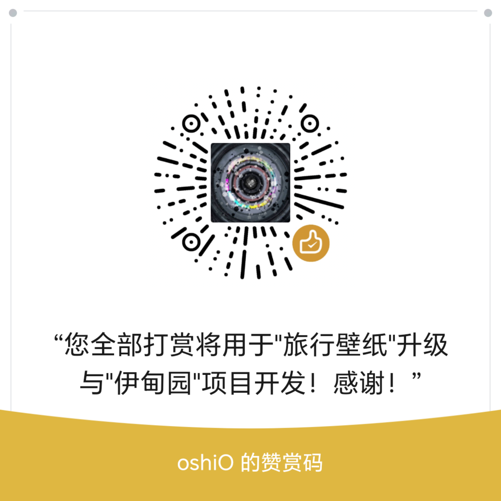

# 旅行壁纸

**带心爱的角色去旅行。是当旅客、扶老奶奶过马路，还是改变整个世界，由你主导。**

一款免费开源的 **DeepSeek Harness（DSH）插件**。把喜欢的角色、自己的赛博分身，或纯粹的好奇心送往不同世界：生成桌面壁纸，留下世界见闻、角色来信和旅途收藏，再由你决定下一幕。

**最多三名同行 · 20种画风 · 50个预设世界 · 每日自动更新 · 今日／次日剧情 · 特产收藏**

[下载与版本](https://github.com/chokingson/dsh-travel-wallpaper/releases) · [安装说明](docs/INSTALL.md) · [问题反馈](https://github.com/chokingson/dsh-travel-wallpaper/issues) · [更新记录](docs/CHANGELOG.md) · [自愿支持](#关于与支持)


*0.15.1本机实测：三张角色参考图共同生成；环境采用电影写实画风，三名角色保持二次元形象。示例展示一次实际结果，不保证每次生成效果相同。*

> 当前版本 **0.15.1**。查看[版本说明与安装包](https://github.com/chokingson/dsh-travel-wallpaper/releases/tag/v0.15.1)，或[直接下载安装包](https://github.com/chokingson/dsh-travel-wallpaper/releases/latest/download/dsh-travel-wallpaper.tgz)。本地整合与代表性联调已完成，具体已测范围见下方记录。
>
> 插件免费，生图使用你自己的订阅、API额度或本地模型。**Windows静态壁纸无需小红车，也无需安装其他生图插件。**

## 这是一趟怎样的旅行

今天带大肥鱼逛宋朝夜市，明天和龙娘登上浮岛；也可以让三位角色结伴走进同一个世界。角色会按各自的人设参与剧情，由第一位主角色给你写一封短短的旅行来信。

你可以顺着故事走，也可以随时改主意：回信让角色带点特产，干涉世界发生的事件，选择今日剧情，或提前安排明天的行动。不想带角色时，切换为“观察世界”，让桌面只记录世界本身。

**选角色与画风 → 确认目的地 → 生成壁纸 → 看见闻与来信 → 决定下一幕 → 收到旅途收藏。**

目的地可以保持不变，继续发生新故事；也可以立即出发，把下一个世界交给盲盒。每天自动更新，并不意味着每天都强制换一个世界。

## 0.15.1 新增与改进

| 内容 | 现在可以做什么 |
| --- | --- |
| **最多三名同行** | 默认角色与自定义角色混选，按选择顺序组成队伍，各自保存名称、外观、人设、称呼和参考图 |
| **今日／次日剧情** | A、B、C竖排选择，或填写自定义剧情；选中后高亮，点击“继续”才生效 |
| **保留回信与干涉** | 直接吩咐角色，或直接改变世界；与剧情选项并存，使用不同入口表达想法 |
| **50世界到访进度** | 成功到访后计入进度；本轮已经到访的预设世界不再进入随机池，集齐50个才开启新一轮 |
| **“特产”图鉴** | 50个预设世界各一件固定物品，配齐50张正式图；新世界可以实时设计并生成新的收藏物 |
| **更可靠的每日任务** | 启动后补执行、失败重试、保留已完成阶段；每日任务、手动生成、预约与剧情任务独立记录 |
| **登录失效提示** | 明确显示订阅失效，并提供重新登录入口；成功重新登录后接续当前行程可恢复的任务 |
| **实机修补** | 修复浮球脚本变长后无法启动的问题；动态物品透明底合成为真实白底，旧图查看时可修复 |

完整变更和验证范围见[版本说明](docs/RELEASE-0.15.1.md)及[本机实测记录](docs/RUNTIME-VERIFICATION-2026-11-15.md)。

## 先看几个玩法

| 想怎么玩 | 可以这样写 |
| --- | --- |
| 带喜欢的角色出门 | 带大肥鱼去宋朝夜市，跟着一只叼铜钱的猫找到卖点心的小摊 |
| 多人结伴 | 大肥鱼、龙娘和大小姐在雾海灯塔旁研究一张旧海图，各自做不同的事 |
| 用自己的赛博分身旅行 | 上传自己的照片或原创形象，去蒸汽雾都乘飞艇，或在外星集市挑一件纪念品 |
| 写实环境里的二次元角色 | 电影写实的海岸、雾气和光线；角色继续保持参考图中的二次元形象 |
| 自己决定剧情 | 让海面同时涨潮和退潮，同一个角色在两个交叠空间里出现 |
| 只观察世界 | 不启用角色，观看未来城市的透明棱镜雨、地底菌光迷宫或一场异星集市 |
| 把壁纸做成世界中的文字载体 | 让消息出现在报纸、竹简、石壁、全息屏、广告大屏或办公桌显示器上 |


*实际自定义剧情测试：多个看似矛盾的要求被作为同一份创作需求组织成一张图；不会因此拆成多次生图任务。*

<details>
<summary>更多旅行画面：夜班超商、江东集市、纸鸢峡谷</summary>

**大零蛋超商夜班共和国 · Claude 大小姐**


**下一站江东 · DS大肥鱼（早期样图）**


**纸鸢风骨峡 · GPT 龙娘**


</details>

## 安装与第一次出发

### 你需要准备

| 项目 | 用途 |
| --- | --- |
| **DSH** | 必须。插件设置、文字创作和定时任务运行在DSH中 |
| **可用的文字模型** | 用于世界创作、剧情、提示词、见闻和来信。默认使用DSH的DeepSeek Flash，推理Off |
| **一种可用的生图渠道** | ChatGPT订阅、符合条件的Google订阅、自己的API，或自行配置的本地环境 |
| **Wallpaper Engine** | 可选。单张Windows壁纸不需要；多张轮播需要 |

**文字模型额度与生图账户额度是两回事。** 插件不提供共享账号、不赠送额度，也不购买订阅。

### 安装

1. 安装并打开[DeepSeek Harness](https://github.com/deepseek-ai/deepseek-harness)。
2. 到本项目[Releases](https://github.com/chokingson/dsh-travel-wallpaper/releases)下载作者实际发布的 `.tgz` 安装包。普通用户无需下载整份源码，也不用自行解压安装包。
3. 使用DSH支持的本地插件安装方式安装该文件。可以把安装包的本机路径告诉DSH，请它处理安装；不同DSH版本的入口可能不同，详见[安装说明](docs/INSTALL.md)。
4. 打开 **DSH设置 → 旅行壁纸**。如果没有出现分栏，先核对插件是否真正安装并启用，不要仅凭附件上传成功判断安装成功。

升级时请保留原有数据。通常无需先卸载旧版，更不要删除整个DSH数据目录。

### 第一次生成

1. 在 **渠道设置** 中登录生图订阅，或填写自己的API配置。
2. 选择 **角色旅行** 或 **观察世界**。
3. 想保持角色外形，开启 **图生图模式** 并选择参考图；想完全用文字创作，则使用文生图。
4. 在 **创作提示词** 中选择画风、填写需求，输入、选择或生成目的地，然后 **确认此行程**。
5. 先用一张壁纸测试，点击 **制作今日壁纸**。确认生成和换图正常后，再开启每日自动更新或多图轮播。

所有设置以后仍可在DSH设置内修改。灰字只是输入示例，开始输入后会消失，不会自动作为你的创作内容。

## 三种出发方式

| 按钮 | 使用场景 | 执行方式 |
| --- | --- | --- |
| **制作今日壁纸** | 已选好世界，想生成一张新图或继续当前旅行 | 按当前确认的参数制作新的一组；同一天可再次生成 |
| **立即盲盒旅行** | 现在就想去一个未知目的地 | 保留所选角色及画风、渠道、参考图和尺寸，由DSH创作50个预设之外的新世界与事件 |
| **盲盒旅行预订** | 把明天留给未知世界 | 锁定预约时的角色选择，到设置时间再执行；支持取消 |

生成时按钮显示等待状态，当前任务结束后才能继续点击。完成后分别显示壁纸与相关消息的结果。手动再制作会使用新的生成请求，可能消耗新的额度。增加每日张数或频繁重新制作，也会增加等待时间与生图消耗。

盲盒世界由模型创作，不用本地预设冒充模型结果；会检查已到访名称并尝试避免重复，但不能保证模型永远不产生相似设定。

## 角色：一个人出发，或三人结伴

内置 **DS大肥鱼、GPT龙娘、Claude大小姐** 参考形象，也可上传自己的角色、宠物或照片。最多选择三名同行者，默认共同出镜；可以在提示词中明确指定某张图只出现部分成员。

每名同行者分别拥有：

- **名称**：用于显示和归档，不靠名字猜测是否为同一个身份。
- **人设／参考设定**：位于名称下方，可写性格，也可说明参考图里的世界、物品或其他用途。
- **对你的称呼**：默认“用户”，可以为每名角色单独修改。
- **外观与身份**：提供文字可理解的识别特征。
- **参考图**：图生图时按同行顺序传递，不把第二、第三张悄悄丢掉。

**第一个选中的角色是主角色，只有主角色写旅行来信。** 移除主角色后，剩余队伍中的第一位接任。多人共同行动不意味着每人都写一封信或各送一份礼物。

| 模式 | 角色如何参与 | 是否发送参考图 |
| --- | --- | --- |
| **角色旅行＋图生图** | 使用所选角色的身份、人设及对应参考图 | 发送实际启用的角色图，最多三张；无图成员仅按文字描述 |
| **角色旅行＋文生图** | 仍然有角色，使用各自文字身份与人设 | 不读取、不发送已保存图片 |
| **观察世界** | 不启用固定旅行角色，不生成角色日记或来信；世界仍可有当地居民 | 本轮实际验证无角色文生图，不发送保存的角色图 |

切换模式会保留原来的角色设置，方便之后切回。文本写稿模型没有看过参考图时，只使用你提供的描述；图片交由实际收到参考图的生图模型理解。

## 今日剧情、次日剧情、回信与干涉

四种入口都保留，你可以用自己喜欢的方式参与世界。

| 入口 | 你在决定什么 | 什么时候生效 |
| --- | --- | --- |
| **今日剧情** | 从当前已经发生的剧情出发，选择A/B/C之一，或自由输入下一幕 | 点“继续”后立即制作新的壁纸与消息 |
| **次日剧情** | 提前安排这个世界明天如何发展 | 点“继续”后保存完整安排，到每日任务执行时生效 |
| **角色回信** | 直接告诉角色现在想让它做什么 | 提交后生成同世界的新剧情与壁纸 |
| **干涉世界** | 直接改变世界中的事件 | 提交后生成响应干涉的新剧情与壁纸 |

### 选择与输入规则

- A/B/C竖排显示具体剧情。选中先高亮，**不点击“继续”就不会提交**。
- 选项与自定义输入互斥；想换一种方式，先重选。自定义文本不会暗中混入已选选项。
- 关闭窗口不会提交；草稿会保留。世界、队伍或实际剧情变化后，旧选项需要重新读取。
- 今日选项从实际剧情生成，不预先规定正向、反向或固定结局。
- 次日三项在后台分别依照探索、停留和意外的完整规则创作；界面展示A/B/C与具体剧情，不把后台分类词当作选项正文。
- 未指定次日分支时，交由默认续写处理；已保存安排可以通过“恢复随机”并再次确认来取消。

次日剧情保存的是完整文本、日期和执行时间，不是一个会随候选刷新而改变含义的“A”。同日的次日剧情与盲盒预约冲突时会明确提示，不静默覆盖已有安排。

故事会使用已提交的事实和有限前情，但不是完整的文明模拟器。很长的旅行仍可能出现记忆损失或细节矛盾。

## 世界与旅行档案

### 50个预设世界，以及你自己创造的世界

预设覆盖历史、科幻、奇幻、荒诞与日常：宋朝汴京夜市、蒸汽雾都、寒武纪海底奇旅、蛙世界、汪咚星、粘粘星、魔法学院、无尽后室等。

可以直接选择预设，摇一个预设，也可以输入自己的完整世界正文，或让DSH根据方向创作新世界。**预设随机与DSH创作盲盒是两种不同的方式。**

### 已到访世界：累计进度与本轮随机池

“已到访世界”按世界归档相关壁纸，并支持角色筛选、查看生成提示词、重新设为壁纸、单图导出及世界ZIP导出。

预设世界提供 **N/50** 进度：

1. 成功发布且图片存在，才算到访。
2. 本轮已经成功到访的预设世界，不再进入随机抽取池。
3. 集齐50个后，下一次随机开启新一轮；累计到访进度保留。
4. 直接手选仍可回访喜欢的世界。
5. 失败、取消或只看候选不增加进度。自定义世界与DSH新世界另行归档，不占预设50个名额。

同一张多人壁纸可以出现在相关角色筛选中，“全部”不会因此重复计算成三张。

## “特产”：收到另一边世界寄来的东西

特产可以是食品、器具、特殊固液气物质、声光电、灵魂或奇异现象，**不送活体生物**。它们是虚构的旅行收藏，不是真实快递或现实物品承诺。

每件物品都包含固定外观、性质、当地用途、物品图，以及一段说明它为何来到你这里的旁白。可以主动赠送，也可以事故、误投、被迫转交或其他方式抵达，不要求每篇都套“购物—失败—反转”。

| 旅行方式 | 收到经历 |
| --- | --- |
| **带角色旅行** | 送达与一名或多名同行者有关，可以有简短对白体现人设；全队共享一件收到经历 |
| **观察世界** | 来源世界的居民、事件、自然或特殊机制让物品抵达，不强塞默认旅行角色或角色来信 |

来源按 **50%当前世界、50%其他预设世界** 抽取，并在任务中保存；重试不会重新随机换来源。

- 预设50世界各一件固定物品，配齐50张正式白底二次元游戏图鉴图；收到时复用，不每次重新画。
- 抽中当前自定义或DSH新世界时，实时设计当地物品，再生成物品图。**这会额外使用生图额度。**
- 动态物品有自己的档案，不增加预设50件的收藏进度。
- 同一预设物品重复收到，只显示一张物品卡，在详情保留不同收到经历。
- 默认列表只展示真正收到的物品；50世界的收集情况按需展开，不铺满未解锁剪影。
- 特产失败不回滚成功壁纸。正文和图片分别保存，失败可接续缺失阶段。

**当前发放策略：每个本地日期×实际世界／行程×有序队伍，最多一次自动送达。** 同一天继续同一行程，不会每点一次剧情就再刷一件；这是当前版本的默认策略，可在后续版本调整。


*实测动态收藏“虹止棱片”：从自定义世界事实出发，完成物品设计、旁白、图片和入藏；没有占用预设50件进度。*

[50件完整物品与提示词](docs/SPECIALTIES-CATALOG.md) · [正式图素材清单](assets/specialties/manifest.json) · [图像提示词记录](assets/specialties/prompts.json) · [送达故事Skill](skills/travel-specialty-delivery/SKILL.md) · [动态物品设计Skill](skills/travel-specialty-design/SKILL.md)

## 画风、参考图与提示词

### 20种画风

| | | | |
| --- | --- | --- | --- |
| 2.5D国风卡牌 | 二次元 | 赛璐璐 | 写意水墨 |
| 工笔重彩 | 透明水彩 | 古典油画 | 电影写实 |
| 精致像素 | 低多边形 | 黏土定格 | 精致三维 |
| 层叠剪纸 | 新艺术装饰 | 复古海报 | 蒸汽波 |
| 清线漫画 | 史诗幻想 | 几何平涂 | 霓虹概念 |

鼠标悬浮可查看画风预览，不用先改动当前选择。查看作品时可读到生成提示词，画风片段会标红。

**二次元角色进入写实环境，默认仍保留二次元形象。** 写实主要作用于背景、材质、光影和空间；真人参考也不会被统一变成二次元。用户明确要求改变角色画风时，才按具体要求处理。最终一致性受生成模型影响。

### 自己写，或使用内置Skill整理

文生图和图生图分别提供靠前的需求输入框。你可以修改世界、时代、标签、角色、动作、画幅、文字载体和额外要求，也可以完全写自己的正文。

“使用内置Skill规范提示词”开启时，DSH按当前模式整理需求；关闭时保留用户文字与所选设置，直接交给生图模型。它用于减少遗漏和冲突，不保证消除所有生成错误。

默认 **16:9横屏、1920×1080、无字画面**，支持预设或自定义目标尺寸。源图尺寸与最终输出分别保存；渠道返回尺寸较小时可能进行适配，**4K输出文件不等于模型原生4K**。

启用画内文字后，可选择少文字或多文字，以及报纸、竹简、石壁、全息投影、广告大屏、电脑显示器等载体。默认不会强行套成新闻主播演播室。

[文生图Skill全文](skills/travel-text-to-image/SKILL.md) · [图生图Skill全文](skills/travel-image-to-image/SKILL.md)

## 每日更新究竟怎样运行

**新用户默认中国时间06:00；升级保留已经保存的时间。** 可以在每日壁纸设置中修改。

| 情况 | 插件怎样处理 |
| --- | --- |
| 到点且DSH运行 | 自动制作并应用当日壁纸 |
| 到点时关机或DSH未运行 | 当时无法生成；DSH恢复运行后检查并补执行符合条件的任务 |
| 生成失败 | 每隔约3分钟重试，最多三次；可复用的阶段与结果保留 |
| 已收到图但应用失败 | 接续应用阶段，尽量复用已保存图片 |
| 已受理远端任务 | 保留句柄或缓存并接续处理 |
| 请求是否受理不明 | 停止自动重发，提示核对，避免盲目重复消耗 |
| 取消或历史日期失败 | 不让旧任务封锁后续每日任务，也不批量补画过去每天的壁纸 |
| 订阅登录失效 | 显示失效与重新登录入口；在本插件成功登录后恢复当前行程内可接续的任务 |

定时任务依赖DSH运行，不是独立系统服务，也不会在电脑关机时偷偷完成生成。当前没有把“每日自动更新”包装成已经实现的系统空闲检测。

每日自动任务和手动制作分开记录。同一天已完成每日任务后，不会因为再次打开DSH而重复生成；手动再制作仍可使用。

## 生图渠道与依赖

旅行壁纸内置渠道适配，**不需要安装dsh-image-gen等其他生图插件**。上游适配代码的署名与许可仍保留。

| 渠道 | 配置方式与当前验证范围 |
| --- | --- |
| **ChatGPT订阅** | 在插件中登录。本机已实际验证单角色、三角色图生图、无角色文生图和动态物品；不代表所有账号或套餐均可用 |
| **Google／Antigravity订阅** | 提供授权入口。账号资格、模型权限和额度以实际服务为准，不等于任意Google AI订阅都可使用；本轮未逐账户实测 |
| **OpenAI／兼容API** | 填写自己的密钥、地址与模型。多参考图支持取决于具体端点与模型；未知兼容端点会明确限制，不静默丢图 |
| **Gemini API、火山Seedream** | 提供直连配置与对应请求格式；需要自己的可用账户，本轮未逐账户消耗验证 |
| **本地ComfyUI／MOSS** | 保留25步文生图测试工作流，需自行安装模型和环境；当前工作流不伪装成多参考图能力 |

订阅使用兼容登录协议，不是厂商为本插件保证长期可用的公开生图API。登录可能过期，协议或模型权限也可能变化。

## 壁纸应用、锁屏与导出

- **Windows自带壁纸**：无需小红车，适合单张静态壁纸。
- **Wallpaper Engine**：可用于1—20张图片轮播，设置轮换间隔。多张循环需要它。
- **锁屏同步**：可独立开关；多图轮播时锁屏使用第一张静态图。Windows限制导致锁屏未能应用时，分别显示桌面与锁屏结果。
- **下载目录**：可以自定义、选择文件夹，或恢复系统下载目录；导出后显示完整路径。
- **导出命名**：包含世界、角色、日期和实际分辨率；同名文件自动编号，不覆盖原文件。
- **历史作品**：可以重新应用单张图片，或按世界导出ZIP。

当前主要面向Windows。多屏、缩放、企业设备策略与锁屏接口可能因环境不同而变化；已有离线布局矩阵和本机验证，不能推断所有设备都已实测。

## 页面怎么找

| 分栏 | 内容 |
| --- | --- |
| **每日壁纸** | 旅行方式、创作开关、今日／次日剧情、时间、应用方式、锁屏、尺寸、下载目录及预约状态 |
| **参考图** | 默认形象、自定义上传、同行选择，以及每名角色的资料与称呼 |
| **创作提示词** | 用户正文、画风、世界、时代、标签、行程确认与文字要求 |
| **已到访世界** | 世界与角色筛选、历史壁纸、提示词、导出和预设到访进度 |
| **“特产”** | 实际收藏、物品图、收到经历与50件预设进度 |
| **渠道设置** | 生图订阅、API、本地地址，以及DSH文字模型 |
| **关于与支持** | 项目、联系方式、第三方素材与自愿支持 |

桌面悬浮球提供见闻、角色来信及互动入口，可关闭；信件提醒和音效也可按设置关闭。观察模式不显示旅行角色来信。

## 常见问题

<details>
<summary><strong>DSH在运行，为什么还是没有自动换图？</strong></summary>

先看每日时间、任务记录和具体失败阶段。写稿、生图、应用桌面是不同步骤：定时器启动了，不代表后续账户一定可用。

本机曾连续两天按时启动并重试，但GPT刷新登录返回401。重新登录后生成恢复。这类问题不会随额度重置自动消失。

确认当前行程已经“确认”、自动更新已开启，并核对是否已经完成当天的每日任务。不要为了排查而反复删除旧数据。

</details>

<details>
<summary><strong>提示HTTP401、登录失效，怎么办？</strong></summary>

进入“渠道设置”，选择原生图订阅并重新登录。额度、账号登录和Codex的本机操作权限是三回事。重新登录后刷新状态；如果仍失败，提供已去除敏感信息的错误与版本号。

</details>

<details>
<summary><strong>点了某个世界，为什么下一张还像旧世界？</strong></summary>

候选选择和已确认行程分开。选择、编辑或生成新世界后，需要点击“确认此行程”。灰字示例、尚未确认的候选和没有提交的剧情草稿，不自动替换当前旅行。

</details>

<details>
<summary><strong>预设随机为什么会出现以前看过的候选？</strong></summary>

只有实际成功到访才从本轮随机池排除。只摇出来看了一眼、生成失败或取消，不算到访。集齐50个后新一轮可以再次遇见；直接手选也始终允许重访。

</details>

<details>
<summary><strong>每张壁纸都会额外生成一件特产吗？</strong></summary>

不会。同日同一世界／行程与同一有序队伍默认最多一次。预设物品复用已有图；动态物品才需要额外出图。收藏失败不代表已经成功的壁纸也失败。

</details>

<details>
<summary><strong>世界见闻会自动抓取全网当天热点吗？</strong></summary>

当前核心功能是创作虚构世界事件，不是已经接入所有平台的新闻聚合器。现实话题可以手动写入；本地内容来源是否可读，取决于实际环境。不能把未来设想写成已经上线的B站、抖音或小红书全自动抓取能力。

</details>

<details>
<summary><strong>参考图、来信和收藏存在哪里？</strong></summary>

默认在本机DSH用户数据目录下的 `planet-news` 子目录。历史图片、参考图、任务、来信与收藏分别持久保存；自定义下载目录控制导出位置，不等于移动整个内部档案。

云端生成时，实际启用的提示词和参考图会发送给你选择的服务商；文生图不会因为本机保存着图片就自动上传它们。备份、卸载或分享资料前，请检查自己的图片、文本和凭据。

</details>

## 测试记录与当前边界

0.15.1完成 **246项本地自动检查**。本轮本机实际成功产物为 **4张壁纸、1张动态物品图**，覆盖GPT单／三角色图生图、无角色文生图、今日自定义剧情、桌面与锁屏；还验证了真实定时器补执行、次日全文保存、重复请求幂等、自定义目录导出及收藏进度。

无角色测试首次写稿返回空正文，未提交生图请求，重试后完成；这项失败保留在实测记录中。预约跨日、取消、重启与故障接续使用可控时钟端到端检查，没有通过修改系统时钟冒充隔夜实测。

Google及各类API未逐账户实测，声音没有做扬声器试听。多屏/DPI有离线WPF布局矩阵，不代表覆盖所有真实硬件。

当前不提供壁纸共享社区、视频生成或视频／网页桌面设置；不保证角色与中文永远正确，也不保证长期世界历史永久无矛盾。请遵守法律法规、服务规则，并尊重素材创作者和其他人的权利。

[完整验收记录](docs/RUNTIME-VERIFICATION-2026-11-15.md) · [版本说明](docs/RELEASE-0.15.1.md)

## 反馈与参与

欢迎到[GitHub Issues](https://github.com/chokingson/dsh-travel-wallpaper/issues)报告问题、提出世界或玩法建议。反馈请写清插件版本、DSH版本、Windows环境、操作步骤、期待结果和实际结果；可附已检查的截图或错误信息，不要上传密钥、Cookie、登录令牌或整份私人配置。

作者：**消尽森（chokingson）**。公开微信：**`q871282948`**。

这是作者第一个准备公开维护的免费开源练手项目。欢迎Star、试用和反馈；支持与否不影响任何功能、角色、额度、反馈优先级或更新。

## 开发与文档

```bash
npm install
npm test
npm pack --ignore-scripts
```

以上用于安装依赖、本地检查和打包，不会因此自动获准真实生图、播放声音或改变桌面。公开仓库不应包含私人配置、角色照片、旅行图库或运行凭据。

| 文档 | 用途 |
| --- | --- |
| [开发与安装细节](docs/DEVELOPMENT.md) | 内部包名、DSH组合入口、维护与高级安装 |
| [版本历史](docs/CHANGELOG.md) | 已发布及本地整合变更 |
| [50世界资料](WORLD-CASES.md) | 预设世界与创作设定 |
| [50件特产](docs/SPECIALTIES-CATALOG.md) | 完整固定物品资料与图像提示词 |
| [素材与第三方代码](THIRD_PARTY_NOTICES.md) | 署名、许可、来源及待核实项 |
| [支持说明](SUPPORT.md) | 自愿支持与公开联系方式 |

作者拥有权利的源码采用 **[Apache-2.0](LICENSE)**。第三方代码保留原许可；角色参考图、预览及示例中的第三方角色元素不随代码许可证重新授权。自愿支持开发不代表获得第三方素材商业使用授权，具体来源和条件见下方及素材说明。

<!-- ABOUT-SUPPORT:START -->
## 关于与支持

旅行壁纸是一款免费的 DSH 插件。带上喜欢的角色或自己的赛博分身，前往不同世界，留下壁纸、世界见闻和角色来信；也可以不带角色，静静观察世界。

[GitHub 项目](https://github.com/chokingson/dsh-travel-wallpaper) · [问题反馈](https://github.com/chokingson/dsh-travel-wallpaper/issues) · [可更新的支持页面](https://github.com/chokingson/dsh-travel-wallpaper/blob/main/SUPPORT.md)

支持说明随本版 SUPPORT.md 发布；若链接无法打开，请通过作者微信联系。

作者公开微信：`q871282948`。

### 自愿支持开发

旅行壁纸免费开源，所有功能均无需付费解锁。

如果它给你带来了快乐，欢迎量力而行，自愿支持作者开发。

支持不购买商品、服务或投资权益，不提供本金、利息、分红或其他投资收益回报。

所获支持将用于旅行壁纸的维护改进，以及作者原创项目‘伊甸园’的制作。

误付或其他收款问题，请联系作者核实处理。

支持与否不影响任何功能、角色、生成额度、反馈优先级和更新。

进入插件“关于与支持”分栏即显示作者赞赏码，可放大查看。不自动弹窗、不设红点、不催促、不做付款解锁。



### 独立项目说明

本项目为独立开发的工具，与所提及的模型厂商及第三方角色创作者无隶属或代言关系。

### 素材说明

第三方角色参考图的作者、来源及使用条件单独列明，不随本项目代码许可证重新授权。自愿支持作者开发不代表获得第三方素材的商业使用授权。

### 鲸鱼娘／DS大肥鱼

上善无形（原角色）；ZipZipPipe（DeepSeek 元素女仆二次设计）。

DeepSeek 特定形象的二次设计遵循原角色 CC BY-NC-SA 4.0：署名、非商业性使用、相同方式共享；本项目不另授商业使用权。

已核实 ZipZipPipe《AI娘化》公开说明中的署名、不可商用要求及 DeepSeek 形象的许可声明。包内两张图片来自 FishArchive；单张绘者、加工者及其与原帖原图的逐一对应关系待核实，上善无形的原始授权声明本次未能直接读取。

包内文件：`assets/characters/deepseek.webp`、`assets/characters/deepseek-full.webp`。

[上善无形 · 作者主页](https://space.bilibili.com/4456176) · [ZipZipPipe ·《AI娘化》](https://www.pixiv.net/artworks/148186519) · [FishArchive · 来源图鉴](https://fisharchive.cc/characters) · [鲸鱼娘 Q版 · 取用文件](https://fisharchive.cc/character-art/v1/view/deepseek-chibi.webp) · [鲸鱼娘立绘 · 取用文件](https://fisharchive.cc/character-art/v1/view/deepseek-full.webp) · [CC BY-NC-SA 4.0](https://creativecommons.org/licenses/by-nc-sa/4.0/deed.zh-hans)

### GPT 龙娘

ZipZipPipe，《AI娘化》。

作者要求署名、不可商用；未确认对该角色适用其他具体 CC 许可，不将鲸鱼娘的许可扩大套用于 GPT 龙娘。

已核实《AI娘化》作者及其公开署名、不可商用说明。包内参考图来自 FishArchive；该文件与原帖单图的对应、转制加工者及完整授权链待核实。

包内文件：`assets/characters/gpt.webp`。

[ZipZipPipe ·《AI娘化》](https://www.pixiv.net/artworks/148186519) · [作者 · AI角色发布动态](https://www.bilibili.com/opus/1233069202138464289) · [GPT立绘 · 取用文件](https://fisharchive.cc/character-art/v1/view/chatgpt-full.webp)

### Claude 大小姐

ZipZipPipe，《AI娘化》。

作者要求署名、不可商用；未确认对该角色适用其他具体 CC 许可，不将鲸鱼娘的许可扩大套用于 Claude 大小姐。

已核实《AI娘化》作者及其公开署名、不可商用说明。包内参考图来自 FishArchive；该文件与原帖单图的对应、转制加工者及完整授权链待核实。

包内文件：`assets/characters/claude.webp`。

[ZipZipPipe ·《AI娘化》](https://www.pixiv.net/artworks/148186519) · [作者 · AI角色发布动态](https://www.bilibili.com/opus/1233069202138464289) · [Claude立绘 · 取用文件](https://fisharchive.cc/character-art/v1/view/claude-full.webp)

维护方法见 [SUPPORT.md](SUPPORT.md)。
<!-- ABOUT-SUPPORT:END -->
