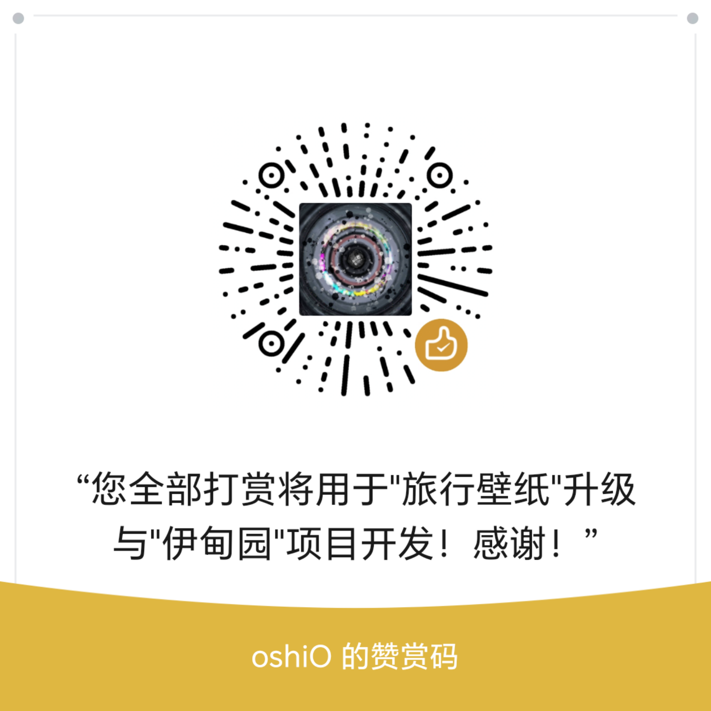

# 旅行壁纸：关于与支持

## 关于与支持

旅行壁纸是一款免费的 DSH 插件。带上喜欢的角色或自己的赛博分身，前往不同世界，留下壁纸、世界见闻和角色来信；也可以不带角色，静静观察世界。

[GitHub 项目](https://github.com/chokingson/dsh-travel-wallpaper) · [问题反馈](https://github.com/chokingson/dsh-travel-wallpaper/issues) · [可更新的支持页面](https://github.com/chokingson/dsh-travel-wallpaper/blob/main/SUPPORT.md)

支持说明随本版 SUPPORT.md 发布；若链接无法打开，请通过作者微信联系。

作者公开微信：`q871282948`。

### 自愿支持开发

旅行壁纸免费开源，所有功能均无需付费解锁。

如果它给你带来了快乐，欢迎量力而行，自愿支持作者开发。

支持不购买商品、服务或投资权益，不提供本金、利息、分红或其他投资收益回报。

所获支持将用于旅行壁纸的维护改进，以及作者原创项目‘伊甸园’的制作。

误付或其他收款问题，请联系作者核实处理。

支持与否不影响任何功能、角色、生成额度、反馈优先级和更新。

进入插件“关于与支持”分栏即显示作者赞赏码，可放大查看。不自动弹窗、不设红点、不催促、不做付款解锁。

### 独立项目说明

本项目为独立开发的工具，与所提及的模型厂商及第三方角色创作者无隶属或代言关系。

### 素材说明

第三方角色参考图的作者、来源及使用条件单独列明，不随本项目代码许可证重新授权。自愿支持作者开发不代表获得第三方素材的商业使用授权。

### 鲸鱼娘／DS大肥鱼

上善无形（原角色）；ZipZipPipe（DeepSeek 元素女仆二次设计）。

DeepSeek 特定形象的二次设计遵循原角色 CC BY-NC-SA 4.0：署名、非商业性使用、相同方式共享；本项目不另授商业使用权。

已核实 ZipZipPipe《AI娘化》公开说明中的署名、不可商用要求及 DeepSeek 形象的许可声明。包内两张图片来自 FishArchive；单张绘者、加工者及其与原帖原图的逐一对应关系待核实，上善无形的原始授权声明本次未能直接读取。

包内文件：`assets/characters/deepseek.webp`、`assets/characters/deepseek-full.webp`。

[上善无形 · 作者主页](https://space.bilibili.com/4456176) · [ZipZipPipe ·《AI娘化》](https://www.pixiv.net/artworks/148186519) · [FishArchive · 来源图鉴](https://fisharchive.cc/characters) · [鲸鱼娘 Q版 · 取用文件](https://fisharchive.cc/character-art/v1/view/deepseek-chibi.webp) · [鲸鱼娘立绘 · 取用文件](https://fisharchive.cc/character-art/v1/view/deepseek-full.webp) · [CC BY-NC-SA 4.0](https://creativecommons.org/licenses/by-nc-sa/4.0/deed.zh-hans)

### GPT 龙娘

ZipZipPipe，《AI娘化》。

作者要求署名、不可商用；未确认对该角色适用其他具体 CC 许可，不将鲸鱼娘的许可扩大套用于 GPT 龙娘。

已核实《AI娘化》作者及其公开署名、不可商用说明。包内参考图来自 FishArchive；该文件与原帖单图的对应、转制加工者及完整授权链待核实。

包内文件：`assets/characters/gpt.webp`。

[ZipZipPipe ·《AI娘化》](https://www.pixiv.net/artworks/148186519) · [作者 · AI角色发布动态](https://www.bilibili.com/opus/1233069202138464289) · [GPT立绘 · 取用文件](https://fisharchive.cc/character-art/v1/view/chatgpt-full.webp)

### Claude 大小姐

ZipZipPipe，《AI娘化》。

作者要求署名、不可商用；未确认对该角色适用其他具体 CC 许可，不将鲸鱼娘的许可扩大套用于 Claude 大小姐。

已核实《AI娘化》作者及其公开署名、不可商用说明。包内参考图来自 FishArchive；该文件与原帖单图的对应、转制加工者及完整授权链待核实。

包内文件：`assets/characters/claude.webp`。

[ZipZipPipe ·《AI娘化》](https://www.pixiv.net/artworks/148186519) · [作者 · AI角色发布动态](https://www.bilibili.com/opus/1233069202138464289) · [Claude立绘 · 取用文件](https://fisharchive.cc/character-art/v1/view/claude-full.webp)

## 公开资料维护

作者只需编辑包内 `about-support.json`，可更新公开微信、项目/反馈/支持页面链接及说明；不从本机私人配置推断资料。二维码固定使用 `assets/support/wechat-appreciation.png`，必须是作者明确提供并允许公开的微信官方赞赏码，不能替换成付款码或登录二维码。修改公开资料后运行 `node scripts/sync-about-docs.mjs` 同步本文、README与素材说明。

将 `support.enabled` 改为 `false` 可暂停该安装版本的赞赏码展示与本机图片接口；下一次进入分栏重新读取。发布新版时同样可关闭。若希望GitHub支持页面也停止展示，请同时移除SUPPORT.md/README里的图片并调整发布文件。已加载页面或他人已经保存的图片不会被撤销。此插件不自动联网拉取远程配置，更新在线说明不能远程关闭用户离线副本。

缺少公开联系方式、有效链接或赞赏图时，页面显示待配置，不影响其它功能。微信号可主动复制，剪贴板权限失败时可手动选择。链接由用户主动打开，不自动请求第三方站点。

核实日期：2026-11-08。ZipZipPipe说明核对入口：[Pixiv公开作品资料](https://www.pixiv.net/ajax/illust/148186519)；第三方索引只作来源线索，不替代作者对具体文件的授权。当前原图与作者原帖的逐项对应仍需补充，不能仅凭整理站的统一页脚推定所有作品采用同一许可。
